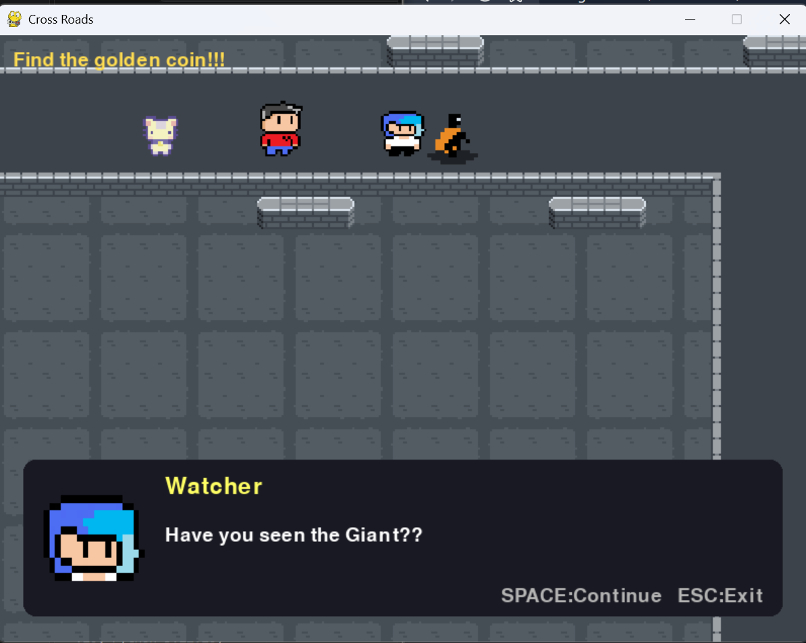

# Cross-Road
A spooky game made using pygame.

# Why I made it
It kind of followed the theme of Week-3 of Terra which was Spooky. So I made a dungeon game. The movement is simple with Arrow Keys and you interact with the surrounding with 'E'. The game is dungeon explorer along with escape theme.

Some assets are made by me but the player and surrounding asset were downloaded. See the credits in LICENSE.

## Run in a browser

You can go to: https://zeta-samuel.github.io/Cross-Road/



Install the requirements and start Pygbag from the repository root:

```shell
python -m pip install -r requirements.txt
python -m pygbag game
```

Open the localhost URL printed by Pygbag (usually `http://localhost:8000`) and
click the page once the game has loaded.

Hint: It is hard to beat the game in first try so try to memorize the map-layout :)


